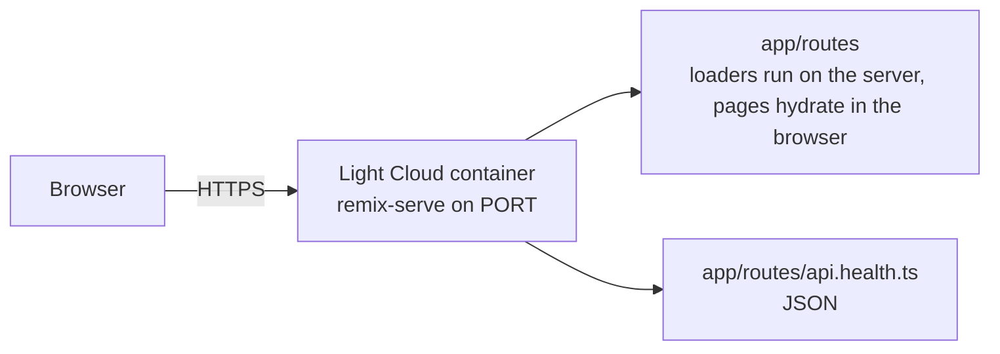

<p align="center">
  
</p>

<h1 align="center">Remix Boilerplate</h1>

<p align="center">
  A Remix v2 app on Vite, ready to deploy on Light Cloud.
</p>

<p align="center">
  <a href="https://www.light-cloud.com/templates/starter-remix"></a>
</p>

---

## Features

- Remix v2 on Vite, React 18 with server-side rendering, TypeScript
- Root layout with a shared header component and a root `loader`
- Home (with a `loader`), About and a resource route at `/api/health`
- Tailwind CSS, ESLint and Vitest
- Served by `remix-serve`

## How it works



## Project structure

```text
.
├── app/
│   ├── root.tsx                # Document, layout, root loader
│   ├── components/SiteHeader.tsx
│   ├── routes/
│   │   ├── _index.tsx          # /
│   │   ├── about.tsx           # /about
│   │   └── api.health.ts       # GET /api/health -> {"status":"ok"}
│   ├── entry.client.tsx
│   ├── entry.server.tsx
│   └── tailwind.css
├── test/                       # Vitest tests (kept out of app/routes, where every file is a route)
├── public/                     # Files served from /
├── .env.example
├── .eslintrc.cjs
├── tailwind.config.ts
└── vite.config.ts
```

## Local development

```bash
npm install         # install dependencies
npm run dev         # dev server on http://localhost:5173
npm run lint        # ESLint
npm run typecheck   # TypeScript
npm test            # Vitest
npm run build       # production build into build/
npm start           # run the production server (honours PORT)
```

## Environment variables

Copy `.env.example` to `.env`. Remix reads `process.env` on the server only, in loaders and actions, when a request comes in; the root loader passes `SITE_NAME` to the header. Send the browser only what it needs through loader data, never secrets.

## Deploy to Light Cloud

### 1. Create an Account

Visit [console.light-cloud.com](https://console.light-cloud.com) and sign up with GitHub or Google.

### 2. Create New Application

1. Click **"New Application"** in the dashboard
2. Select **"Container"** as the deployment type
3. Choose **"Remix"** as the framework

### 3. Connect Repository

- **Option A:** Fork this repository and connect it via GitHub
- **Option B:** Push this code to your own GitHub repository and connect it

### 4. Configure Settings

Light Cloud will auto-detect your settings, but you can verify:

| Setting | Value |
|---------|-------|
| Port | `3000` |
| Start Command | `npm start` |

### 5. Deploy

Click **"Deploy"** and your app will be live in minutes!

Your app will be available at `https://your-app.light-cloud.io`

## Learn More

This starter began as `create-remix` output and adds the structure described above.

- [Remix documentation](https://remix.run/docs)
- [Light Cloud documentation](https://docs.light-cloud.com)

## License

[MIT](./LICENSE)

---

<p align="center">
  <a href="https://light-cloud.com">Website</a> •
  <a href="https://docs.light-cloud.com">Documentation</a> •
  <a href="https://console.light-cloud.com">Console</a>
</p>

<p align="center">
  Made with ☁️ by <a href="https://light-cloud.com">Light Cloud</a>
</p>
