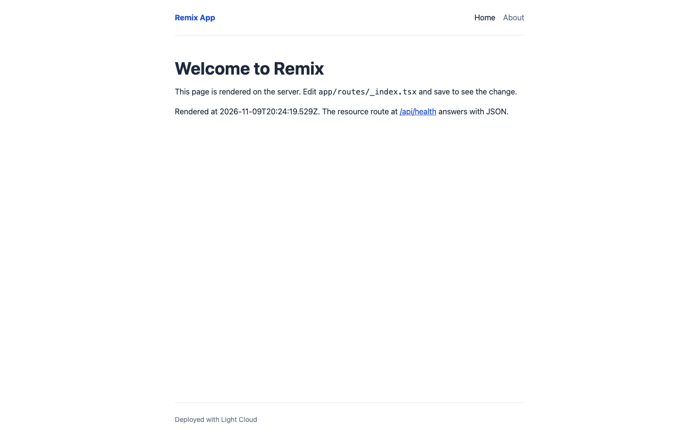
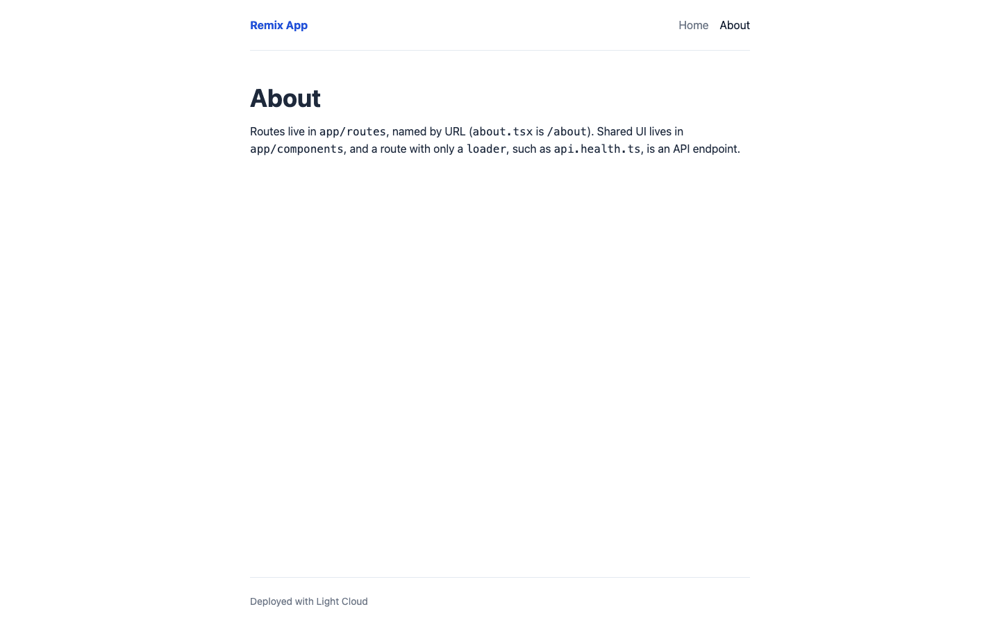
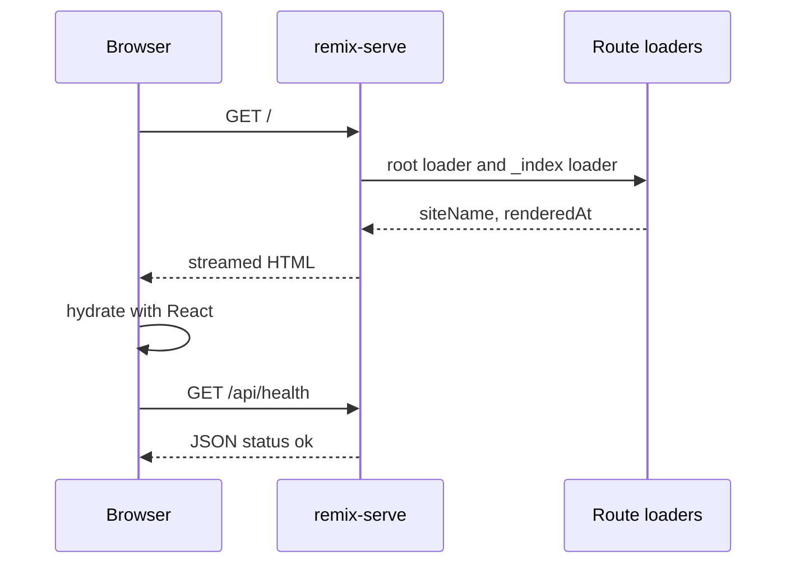

# Remix v2 Vite Starter

[](LICENSE) [](https://remix.run) [](https://react.dev) [](https://nodejs.org) [](test) [](https://github.com/light-cloud-templates/remix-vite-starter/generate) [](https://www.light-cloud.com/templates/remix-vite-starter)

A Remix v2 starter on Vite with React 18, TypeScript and Tailwind CSS, rendered on a Node.js server by `remix-serve`. It is a small boilerplate for developers who want a working server-rendered Remix app with a root layout, route loaders, a JSON resource route, ESLint and Vitest already set up. It runs on any host that runs Node.js 20, and deploys to Light Cloud in one click.

## Screenshot




## Features

- Remix 2.17 on Vite 5, React 18 with server-side rendering and streaming (`renderToPipeableStream`)
- TypeScript, with the `~/` import alias for `app/`
- Root layout in `app/root.tsx` with a shared header and a root `loader` that passes `SITE_NAME` to it
- Home page with a `loader`, an About page, and a resource route at `GET /api/health`
- Tailwind CSS 3 through PostCSS
- Three Remix v3 future flags turned on: `v3_fetcherPersist`, `v3_relativeSplatPath`, `v3_throwAbortReason`
- ESLint 8 with React, hooks, accessibility, import and TypeScript rules
- A Vitest test for the resource route, kept in `test/` because every file in `app/routes/` is a route
- Served by `remix-serve`, which listens on `PORT`

## Quick start

You need Node.js 20 or later and npm.

```bash
git clone https://github.com/light-cloud-templates/remix-vite-starter.git
cd remix-vite-starter
npm install
cp .env.example .env
npm run dev
```

Open <http://localhost:5173>. Edit `app/routes/_index.tsx` and the page updates.

Other ways to start:

- **Use this template**: press [Use this template](https://github.com/light-cloud-templates/remix-vite-starter/generate) to create your own repository from this one.
- **Deploy to Light Cloud**: open the [template page](https://www.light-cloud.com/templates/remix-vite-starter) and press Deploy to get a running copy.

## Deploy

### Deploy to Light Cloud

[](https://www.light-cloud.com/templates/remix-vite-starter)

The Deploy button copies this template into your GitHub account and creates a server app: Light Cloud runs `npm run build`, then `npm start` (`remix-serve ./build/server/index.js`) in a container that listens on the port in `PORT`.

There are no secrets to fill in. Every push to the default branch deploys again. The Free plan includes up to 3 server apps.

### Deploy anywhere else

This is a standard Remix app with no Light Cloud code in it. Any host that runs Node.js 20 or later runs it: `npm ci`, `npm run build`, then `npm start`. `remix-serve` reads `PORT` (default `3000`) and serves the browser assets from `build/client`.

## Project structure

```text
.
├── app/
│   ├── root.tsx                # document, layout, root loader
│   ├── components/SiteHeader.tsx
│   ├── routes/
│   │   ├── _index.tsx          # /
│   │   ├── about.tsx           # /about
│   │   └── api.health.ts       # GET /api/health (resource route)
│   ├── entry.client.tsx        # hydrates the document in the browser
│   ├── entry.server.tsx        # streams the HTML on the server
│   └── tailwind.css            # Tailwind directives
├── test/                       # Vitest tests
├── public/                     # files served from / (favicon.ico)
├── .env.example                # the variables, for local runs
├── .eslintrc.cjs               # ESLint config
├── postcss.config.js
├── tailwind.config.ts
├── tsconfig.json
└── vite.config.ts              # Remix Vite plugin and future flags
```

## Pages

| Path | File | What it shows |
| --- | --- | --- |
| `/` | `app/routes/_index.tsx` | Welcome page with the render time from its `loader` |
| `/about` | `app/routes/about.tsx` | Where routes, components and resource routes live |

## API endpoints

| Method | Path | Description |
| --- | --- | --- |
| `GET` | `/api/health` | Answers `200` with `{ "status": "ok" }` |

```bash
curl http://localhost:5173/api/health
```

After `npm run build && npm start` the server is on port `3000`; on Light Cloud, use your app's URL.

## Environment variables

| Name | Required | Default | What it does |
| --- | --- | --- | --- |
| `PORT` | No | `3000` | Port `remix-serve` listens on. Set by Light Cloud. |
| `SITE_NAME` | No | `Remix App` | Site name in the header, read by the root loader on each request. |

Remix reads `process.env` on the server only, in loaders and actions. Pass what the browser needs through loader data, and never send secrets that way. `npm run dev` loads `.env`; `npm start` reads the real environment.

## Testing

```bash
npm test            # Vitest
npm run lint        # ESLint
npm run typecheck   # TypeScript
```

## How it works



For each request Remix runs the loaders of every matching route on the server, renders the page with their data, and streams the HTML. A route with a `loader` and no default export, such as `api.health.ts`, is a resource route that answers with the loader's response only.

## FAQ

### How do I add a route in Remix?

Create a file in `app/routes/`: `contact.tsx` becomes `/contact`, and dots make path segments, so `blog.first-post.tsx` becomes `/blog/first-post`. Add a `NavLink` to it in `app/components/SiteHeader.tsx`.

### How do I add an API endpoint in Remix?

Add a resource route: a file in `app/routes/` that exports a `loader` (for `GET`) or an `action` (for `POST`, `PUT`, `DELETE`) and no default component. `api.health.ts` is the example.

### Should I use Remix v2 or React Router v7?

Remix v2 continues as React Router v7, and the upgrade path is to turn on the remaining Remix v3 future flags, then switch packages. This template already turns on three of those flags in `vite.config.ts`.

### How do I use environment variables in Remix?

Read `process.env.NAME` in a `loader` or `action`, which run on the server. Return what the page needs from the loader, as the root loader does with `SITE_NAME`.

### Can I deploy it without Light Cloud?

Yes. It is a plain Remix app: any host with Node.js 20 or later runs it with `npm run build` and `npm start`.

## Related templates

- [nextjs-app-router-starter](https://github.com/light-cloud-templates/nextjs-app-router-starter): server-rendered React with the Next.js App Router
- [react-vite-starter](https://github.com/light-cloud-templates/react-vite-starter): a React single-page app served as static files
- [sveltekit-starter](https://github.com/light-cloud-templates/sveltekit-starter): the same pages in SvelteKit
- [nuxt-ssr-starter](https://github.com/light-cloud-templates/nuxt-ssr-starter): the same pages in Nuxt and Vue

## Licence

MIT, see [LICENSE](LICENSE).

---

Maintained by [Light Cloud](https://light-cloud.com): deploy apps, APIs and databases in one click.
