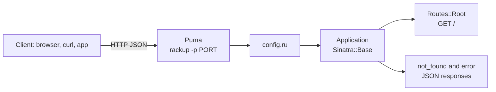

# Sinatra REST API Starter (Ruby)

[](LICENSE) [](https://sinatrarb.com) [](https://www.ruby-lang.org) [](test) [](https://github.com/light-cloud-templates/sinatra-api-starter/generate) [](https://www.light-cloud.com/templates/sinatra-api-starter)

A Sinatra 4 JSON API starter in Ruby 3.2, written in Sinatra's modular style and served by Puma through Rack. It is a minimal, tested Sinatra boilerplate for developers who want a small Ruby API skeleton with JSON errors and Minitest set up, without Rails and without a database. It runs with `bundle exec rackup` anywhere Ruby runs, and deploys to Light Cloud in one click.

## Features

- Sinatra 4.2 on Puma 6, started through Rack (`config.ru`)
- Modular style: `Application < Sinatra::Base` in `app/application.rb`, routes split into extensions under `app/routes/`
- `GET /` answers a JSON welcome message through a small `json` helper
- Unknown routes answer `404` as `{ "error": "Not Found" }`, errors answer `500` as `{ "error": "Something went wrong" }`
- Exception pages turned off (`show_exceptions false`), so errors never leak a stack trace
- Tests with Minitest and Rack::Test, run with `rake`
- Gem versions locked in `Gemfile.lock`

## Quick start

You need Ruby 3.2 or newer and Bundler.

```bash
git clone https://github.com/light-cloud-templates/sinatra-api-starter.git
cd sinatra-api-starter
bundle install
bundle exec rackup -p 3000
```

Open <http://localhost:3000> to see the welcome message. Restart the server after you change a file; there is no auto-reload.

Other ways to start:

- **Use this template**: press [Use this template](https://github.com/light-cloud-templates/sinatra-api-starter/generate) to create your own repository from this one.
- **Deploy to Light Cloud**: open the [template page](https://www.light-cloud.com/templates/sinatra-api-starter) and press Deploy to get a running copy.

## Deploy

### Deploy to Light Cloud

[](https://www.light-cloud.com/templates/sinatra-api-starter)

The Deploy button copies this template into your GitHub account and creates a server app that runs `bundle install` without the development and test gems, then `bundle exec rackup -p $PORT -o 0.0.0.0` in a container with `APP_ENV=production`.

There are no secrets to fill in. Every push to the default branch deploys again. The Free plan includes up to 3 server apps.

### Deploy anywhere else

This is a standard Rack app with no Light Cloud code in it. Any host that runs Ruby 3.2 runs it: `bundle install`, then `bundle exec rackup -p $PORT -o 0.0.0.0` with `APP_ENV=production`. Any server that reads `config.ru` works too.

## Project structure

```text
.
├── app/
│   ├── application.rb     # Application < Sinatra::Base: settings, json helper, error handlers
│   └── routes/
│       └── root.rb        # GET /
├── test/
│   ├── test_helper.rb     # loads Minitest, Rack::Test and the app
│   └── application_test.rb
├── config.ru              # Rack entry point that rackup runs
├── Gemfile                # sinatra, puma, rackup; rake, minitest, rack-test for tests
├── Gemfile.lock           # locked gem versions
├── Rakefile               # rake test
└── .env.example           # the variables the app reads
```

## API endpoints

| Method | Path | Description |
| --- | --- | --- |
| `GET` | `/` | `{ "message": "Hello from Sinatra on Light Cloud" }` |

Any other path answers `404` with `{ "error": "Not Found" }`.

```bash
curl http://localhost:3000/
```

On Light Cloud, use your app's URL instead of `http://localhost:3000`.

## Environment variables

| Name | Required | Default | What it does |
| --- | --- | --- | --- |
| `PORT` | No | `3000` in `.env.example` | Port to listen on, passed to `rackup -p`. Set by Light Cloud. |
| `APP_ENV` | No | `development` | Sinatra environment; `production` on the deployed app. Set by Light Cloud. |

## Testing

```bash
bundle exec rake test
```

`bundle exec rake` does the same, since `test` is the default task. The tests use Rack::Test to call `/` and an unknown route without starting a server.

## How it works



`rackup` reads `config.ru`, which runs `Application`. Each module in `app/routes/` is a Sinatra extension that adds routes when `Application` registers it.

## FAQ

### How do I add a new route in Sinatra?

Create a module in `app/routes/` shaped like `root.rb`, with a `self.registered(app)` method that defines `app.get`, `app.post` and so on. Then `require_relative` it in `app/application.rb` and add `register Routes::Things`.

### What is the difference between classic and modular Sinatra?

Classic style defines routes at the top level of a script. This starter uses modular style, a `Sinatra::Base` subclass, which keeps the app in a class that Rack, tests and other apps can mount without global state.

### Which Ruby version does it need?

The Gemfile asks for Ruby 3.2 or newer, and `Gemfile.lock` was written with Ruby 3.2. Light Cloud builds it on Ruby 3.2.

### How do I add a database?

This starter has none. Add a gem such as `pg` or `sequel` to the Gemfile, connect in `app/application.rb`, and read the connection settings from environment variables.

### Can I deploy it without Light Cloud?

Yes. It is a plain Rack app: any host with Ruby 3.2 runs it with `bundle exec rackup -p $PORT -o 0.0.0.0`.

## Related templates

- [flask-api-starter](https://github.com/light-cloud-templates/flask-api-starter): a similar micro-framework API in Python
- [express-api-starter](https://github.com/light-cloud-templates/express-api-starter): a minimal Node.js API in Express
- [slim-php-api-starter](https://github.com/light-cloud-templates/slim-php-api-starter): a minimal PHP API in Slim
- [dockerfile-starter](https://github.com/light-cloud-templates/dockerfile-starter): bring your own Dockerfile for any language

## Licence

MIT, see [LICENSE](LICENSE).

---

Maintained by [Light Cloud](https://light-cloud.com): deploy apps, APIs and databases in one click.
