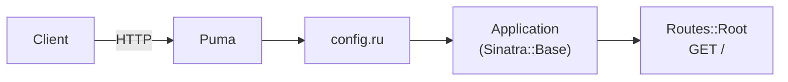

<p align="center">
  
</p>

<h1 align="center">Sinatra API Boilerplate</h1>

<p align="center">
  A Sinatra service served through Rack, ready to deploy on Light Cloud.
</p>

<p align="center">
  <a href="https://console.light-cloud.com/new?repo=https://github.com/light-cloud-com/starter-sinatra"></a>
</p>

---

## Features

- Sinatra 4 on Puma
- Modular style: a `Sinatra::Base` subclass in `app/`, routes split into extensions under `app/routes/`
- JSON responses, including JSON 404 and 500 errors
- Minitest + Rack::Test tests, run with `rake`
- Served through Rack (`config.ru`)

## How it works



## API Endpoints

| Method | Endpoint | Description |
|--------|----------|-------------|
| GET | `/` | Welcome message |

## Project structure

```
.
├── config.ru              Rack entry point (rackup runs this)
├── Gemfile, Gemfile.lock
├── Rakefile               rake test
├── app
│   ├── application.rb     Application < Sinatra::Base: settings, helpers, error handlers
│   └── routes/root.rb     GET /
└── test
    ├── test_helper.rb
    └── application_test.rb
```

Add routes as a new module in `app/routes/` and `register` it in `app/application.rb`.

## Local Development

You need Ruby 3.2 or newer.

```bash
# Install dependencies
bundle install

# Run the server
bundle exec rackup -p 3000

# Run the tests
bundle exec rake test
```

The API will be available at `http://localhost:3000`

## Deploy to Light Cloud

### 1. Create an Account

Visit [console.light-cloud.com](https://console.light-cloud.com) and sign up with GitHub or Google.

### 2. Create New Application

1. Click **"New Application"** in the dashboard
2. Select **"Container"** as the deployment type
3. Choose **"Sinatra"** as the framework

### 3. Connect Repository

- **Option A:** Fork this repository and connect it via GitHub
- **Option B:** Push this code to your own GitHub repository and connect it

### 4. Configure Settings

Light Cloud will auto-detect your settings, but you can verify:

| Setting | Value |
|---------|-------|
| Port | `3000` |
| Start Command | `bundle exec rackup` |

### 5. Deploy

Click **"Deploy"** and your API will be live in minutes!

Your API will be available at `https://your-app.light-cloud.io`

## Learn More

- [Sinatra documentation](https://sinatrarb.com/documentation.html)
- [Rack documentation](https://github.com/rack/rack)
- [Light Cloud documentation](https://docs.light-cloud.com)

---

<p align="center">
  <a href="https://light-cloud.com">Website</a> •
  <a href="https://docs.light-cloud.com">Documentation</a> •
  <a href="https://console.light-cloud.com">Console</a>
</p>

<p align="center">
  Made with ☁️ by <a href="https://light-cloud.com">Light Cloud</a>
</p>
