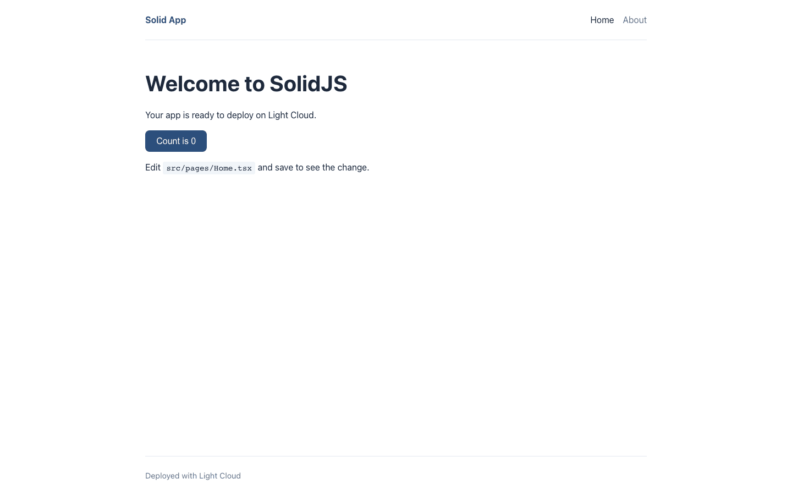
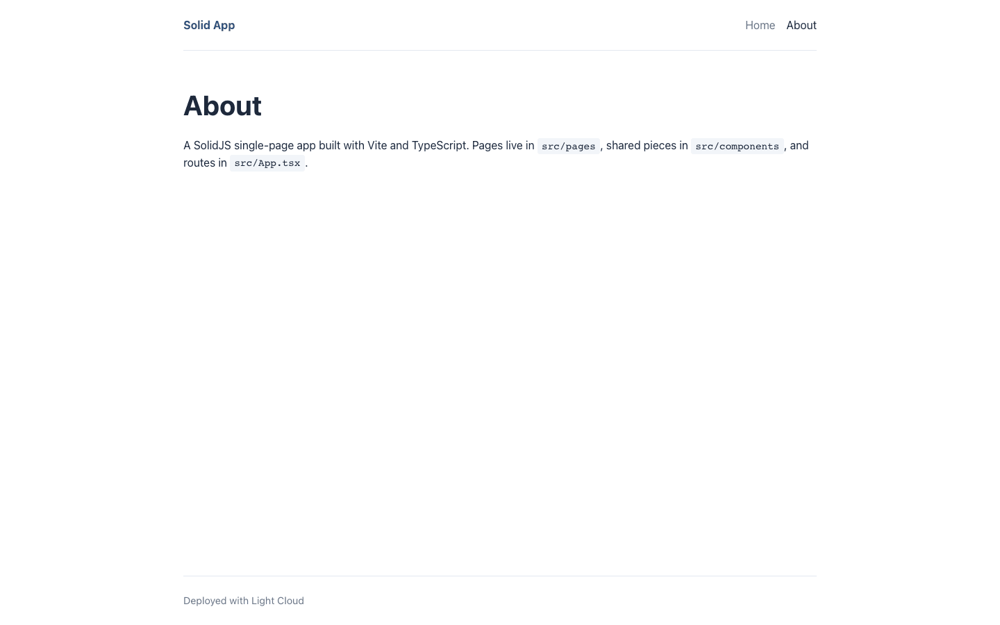
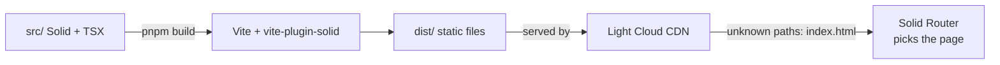

# SolidJS Vite Starter (TypeScript)

[](LICENSE) [](https://www.solidjs.com) [](https://vite.dev) [](https://www.typescriptlang.org) [](src/components) [](https://github.com/light-cloud-templates/solidjs-vite-starter/generate) [](https://www.light-cloud.com/templates/solidjs-vite-starter)

A SolidJS 1.9 starter in TypeScript, built with Vite 7 and Solid Router: a single-page app with a shared layout, a home page, an about page and a 404 page. It is a small boilerplate for developers who want a clean Solid project with signals, CSS Modules, ESLint, type checking and Vitest already set up, ready to add their own pages. It builds to static files that any static host serves, and deploys to Light Cloud in one click.

## Screenshot




## Features

- SolidJS 1.9 with fine-grained reactivity (`createSignal`) and TypeScript in strict mode
- Vite 7 with `vite-plugin-solid`, plus `solid-devtools` in development
- Solid Router: Home, About and a catch-all 404 page; About and 404 are lazy-loaded
- One `Layout` (header, navigation, footer) as the router root
- CSS Modules per component, design tokens and base styles in `src/styles/global.css`
- ESLint flat config with typescript-eslint and eslint-plugin-solid, `tsc` type checking
- Vitest with Solid Testing Library and user-event
- A typed `VITE_APP_TITLE` build-time variable (`src/env.d.ts`), with an `.env.example`

## Quick start

You need Node.js 22.12 or later (Vitest 5 requires it) and pnpm. The lockfile is `pnpm-lock.yaml`; npm also works.

```bash
git clone https://github.com/light-cloud-templates/solidjs-vite-starter.git
cd solidjs-vite-starter
pnpm install
pnpm dev
```

Open <http://localhost:3000> (the port is set in `vite.config.ts`). Edit `src/pages/Home.tsx` and the page updates as you save.

Other ways to start:

- **Use this template**: press [Use this template](https://github.com/light-cloud-templates/solidjs-vite-starter/generate) to create your own repository from this one.
- **Deploy to Light Cloud**: open the [template page](https://www.light-cloud.com/templates/solidjs-vite-starter) and press Deploy to get a running copy.

## Deploy

### Deploy to Light Cloud

[](https://www.light-cloud.com/templates/solidjs-vite-starter)

The Deploy button copies this template into your GitHub account and creates a static site: Light Cloud runs the `build` script and serves the `dist/` folder from a CDN. Paths that are not files, such as `/about`, fall back to `index.html`, so Solid Router handles them.

There are no secrets to fill in. Every push to the default branch deploys again. Static sites run on the Free plan.

### Deploy anywhere else

This is a standard Vite app with no Light Cloud code in it. Run `pnpm build` and upload `dist/` to any static file host (Netlify, Cloudflare Pages, GitHub Pages, S3 with CloudFront, nginx). Because the app uses client-side routing, configure the host to serve `index.html` for paths that do not match a file, or `/about` returns a 404 on reload.

## Project structure

```text
.
├── index.html                  # HTML entry, loads src/index.tsx
├── src/
│   ├── index.tsx               # renders the app into #root
│   ├── App.tsx                 # Router and route table
│   ├── env.d.ts                # types for import.meta.env
│   ├── components/
│   │   ├── Layout.tsx          # header, navigation, footer
│   │   ├── Counter.tsx         # createSignal counter on the home page
│   │   └── Counter.test.tsx    # Vitest + Solid Testing Library
│   ├── pages/                  # Home, About, NotFound
│   ├── styles/global.css       # design tokens and base styles
│   └── test/setup.ts           # jest-dom matchers
├── .env.example                # VITE_ variables
├── eslint.config.js            # ESLint flat config
├── tsconfig.json               # strict TypeScript, Solid JSX
└── vite.config.ts              # Vite and Vitest config, dev port 3000
```

## Pages

| Path | File | What it shows |
| --- | --- | --- |
| `/` | `src/pages/Home.tsx` | Welcome text and a click counter |
| `/about` | `src/pages/About.tsx` | Where pages, components and routes live (lazy-loaded) |
| any other path | `src/pages/NotFound.tsx` | "Page not found" with a link home (lazy-loaded) |

Routes are declared in `src/App.tsx`; links in the header are in `src/components/Layout.tsx`.

## Environment variables

| Name | Required | Default | What it does |
| --- | --- | --- | --- |
| `VITE_APP_TITLE` | No | `Solid App` | Name shown in the header. |

Copy `.env.example` to `.env.local` for local runs. Vite only exposes variables that start with `VITE_` to the browser, and it writes their values into the bundle at build time, so never put secrets in them. Declare new ones in `src/env.d.ts` to keep them typed. On Light Cloud, set them in the app's environment variables and deploy again.

## Testing

```bash
pnpm test         # Vitest, runs once
pnpm lint         # ESLint
pnpm typecheck    # tsc --noEmit
pnpm build        # production build into dist/
pnpm serve        # serves dist/ on http://localhost:4173
```

The tests run in jsdom, so no browser is needed.

## How it works



Solid compiles JSX into direct DOM updates, so a signal change updates only the text that reads it. The browser loads `index.html` and the main bundle once, then Solid Router swaps pages and fetches lazy chunks as they are needed.

## FAQ

### How do I add a new page in a SolidJS app with Solid Router?

Create a component in `src/pages/`, add `<Route path="/contact" component={Contact} />` inside the `<Router>` in `src/App.tsx` (wrap it in `lazy()` to load it on demand), and add an `<A href="/contact">` in `src/components/Layout.tsx`.

### Why does my Solid Router page show a 404 after a refresh?

The host is looking for a file called `/about` and has none. Configure it to serve `index.html` for unknown paths (a rewrite or SPA fallback). Light Cloud does this for you.

### How do I use environment variables in SolidJS with Vite?

Add a line such as `VITE_API_URL=https://api.example.com` to `.env.local`, declare it in `src/env.d.ts`, and read it with `import.meta.env.VITE_API_URL`. Only `VITE_` names reach the browser, and the value is fixed when you build.

### Can I deploy it without Light Cloud?

Yes. Run `pnpm build` and serve `dist/` from any static file host, with a fallback to `index.html` for client-side routes.

### Can I use npm instead of pnpm?

Yes. `npm install` and `npm run dev`, `npm test` and so on use the same scripts. npm creates its own `package-lock.json`; delete `pnpm-lock.yaml` if you switch for good.

## Related templates

- [react-vite-starter](https://github.com/light-cloud-templates/react-vite-starter): the same app in React and Vite
- [vue-vite-starter](https://github.com/light-cloud-templates/vue-vite-starter): the same app in Vue 3 and Vite
- [svelte-vite-starter](https://github.com/light-cloud-templates/svelte-vite-starter): a single-page Svelte 5 app on Vite
- [angular-starter](https://github.com/light-cloud-templates/angular-starter): the same app in Angular and TypeScript

## Licence

MIT, see [LICENSE](LICENSE). Based on the SolidJS TypeScript Vite template.

---

Maintained by [Light Cloud](https://light-cloud.com): deploy apps, APIs and databases in one click.
