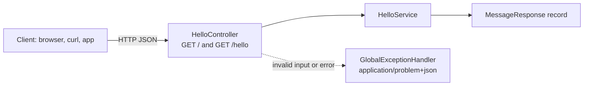

# Spring Boot REST API Starter (Java 17, Maven)

[](LICENSE) [](https://spring.io/projects/spring-boot) [](https://openjdk.org) [](src/test) [](https://github.com/light-cloud-templates/spring-boot-api-starter/generate) [](https://www.light-cloud.com/templates/spring-boot-api-starter)

A Spring Boot 3.5 REST API starter in Java 17, built with Maven and the Maven wrapper, so you do not need Maven installed. It is a small, tested boilerplate for Java developers who want a working Spring Web service with a controller, a service, request validation and RFC 9457 problem JSON errors, ready to rename and extend. It runs with `java -jar` anywhere Java runs, and deploys to Light Cloud in one click.

## Features

- Spring Boot 3.5.3 with Spring Web (embedded Tomcat) and Jakarta Bean Validation
- Package-by-feature layout: controller, service and record DTOs side by side in `hello/`
- Two JSON endpoints: `GET /` and `GET /hello?name=...`
- Request validation: `name` must be 1 to 50 characters, otherwise `400`
- One global exception handler: every error is an RFC 9457 problem (`application/problem+json`), including `404` for unknown routes
- Unexpected errors are logged and answered with a generic `500` problem, so stack traces never reach the client
- `server.port` reads `PORT`, with `8080` as the fallback
- JUnit 5 tests: a `@SpringBootTest` context test and `@WebMvcTest` slice tests with MockMvc
- Maven wrapper (`./mvnw`, Maven 3.9) included

## Quick start

You need a JDK, Java 17 or newer. Maven is downloaded by the wrapper.

```bash
git clone https://github.com/light-cloud-templates/spring-boot-api-starter.git
cd spring-boot-api-starter
./mvnw spring-boot:run
```

Open <http://localhost:8080/hello?name=Ada> to see `{"message":"Hello, Ada!"}`. On Windows, use `mvnw.cmd` instead of `./mvnw`.

Other ways to start:

- **Use this template**: press [Use this template](https://github.com/light-cloud-templates/spring-boot-api-starter/generate) to create your own repository from this one.
- **Deploy to Light Cloud**: open the [template page](https://www.light-cloud.com/templates/spring-boot-api-starter) and press Deploy to get a running copy.

## Deploy

### Deploy to Light Cloud

[](https://www.light-cloud.com/templates/spring-boot-api-starter)

The Deploy button copies this template into your GitHub account and creates a server app: Light Cloud builds the jar with Maven and runs it as a container that listens on the port in `PORT`.

There are no secrets to fill in. Every push to the default branch deploys again. The Free plan includes up to 3 server apps.

### Deploy anywhere else

This is a standard Spring Boot app with no Light Cloud code in it. Any host that runs Java 17 runs it:

```bash
./mvnw clean package
java -jar target/*.jar
```

Set `PORT` if the host expects a port other than `8080`. To build a container image without writing a Dockerfile, `./mvnw spring-boot:build-image` uses Cloud Native Buildpacks (it needs Docker).

## Project structure

```text
.
├── src/
│   ├── main/
│   │   ├── java/com/lightcloud/starter/
│   │   │   ├── StarterSpringbootApplication.java # entry point (@SpringBootApplication)
│   │   │   ├── common/
│   │   │   │   └── GlobalExceptionHandler.java   # every error as application/problem+json
│   │   │   └── hello/
│   │   │       ├── HelloController.java          # GET / and GET /hello
│   │   │       ├── HelloService.java             # builds the messages
│   │   │       └── MessageResponse.java          # record: {"message": "..."}
│   │   └── resources/
│   │       └── application.properties            # server.port=${PORT:8080}
│   └── test/java/com/lightcloud/starter/         # JUnit 5: context test and MockMvc tests
├── pom.xml                                       # Spring Boot parent 3.5.3, Java 17
├── mvnw, mvnw.cmd                                # Maven wrapper scripts
├── .mvn/wrapper/                                 # wrapper settings (Maven 3.9)
└── .env.example                                  # PORT, for reference
```

Add a feature as a new package next to `hello/` with its own controller, service and records.

## API endpoints

| Method | Path | Description |
| --- | --- | --- |
| `GET` | `/` | Welcome message: `{"message": "Hello from Spring Boot on Light Cloud"}` |
| `GET` | `/hello?name=Ada` | Greets `name` (1 to 50 characters, default `World`); `400` problem when it is longer |

Errors use the RFC 9457 problem format, for example `{"type": "about:blank", "title": "Bad Request", "status": 400, ...}`.

```bash
curl "http://localhost:8080/hello?name=Ada"
```

On Light Cloud, use your app's URL instead of `http://localhost:8080`.

## Environment variables

| Name | Required | Default | What it does |
| --- | --- | --- | --- |
| `PORT` | No | `8080` | Port to listen on, read through `server.port`. Set by Light Cloud. |

Any other Spring property can also be set from the environment with Spring's relaxed binding, for example `SPRING_APPLICATION_NAME`.

## Testing

```bash
./mvnw test
```

`StarterSpringbootApplicationTests` checks that the application context starts. `HelloControllerTest` runs the controller through MockMvc without a server: the welcome message, a greeting by name, and a too long name answered as a `400` problem.

## How it works



Spring Boot starts an embedded Tomcat on `server.port`. The controller validates `name`, the service builds the message, and Jackson writes the record as JSON. Anything that goes wrong is turned into a problem response by `GlobalExceptionHandler`.

## FAQ

### How do I change the port of a Spring Boot app?

Set the `PORT` environment variable, for example `PORT=9090 ./mvnw spring-boot:run`. `application.properties` maps it to `server.port` and falls back to `8080`.

### How do I add a new REST endpoint in Spring Boot?

Add a package next to `hello/` with a `@RestController` class and a `@GetMapping` or `@PostMapping` method that returns a record. Spring finds it through component scanning, so there is nothing to register.

### How do I add Swagger UI to this starter?

It has no OpenAPI docs yet. Add the `org.springdoc:springdoc-openapi-starter-webmvc-ui` dependency to `pom.xml`, and springdoc serves Swagger UI at `/swagger-ui.html`.

### How do I connect a database?

Add `spring-boot-starter-data-jpa` (or `spring-boot-starter-jdbc`) and a driver to `pom.xml` and set the `spring.datasource.*` properties from environment variables. For a finished example with PostgreSQL, see [spring-boot-postgresql-crud-api](https://github.com/light-cloud-templates/spring-boot-postgresql-crud-api).

### Can I deploy it without Light Cloud?

Yes. It is a plain Spring Boot app: build it with `./mvnw clean package` and run `java -jar target/*.jar` on any host with Java 17, or build an image with `./mvnw spring-boot:build-image`.

## Related templates

- [spring-boot-postgresql-crud-api](https://github.com/light-cloud-templates/spring-boot-postgresql-crud-api): Spring Boot with a PostgreSQL CRUD API
- [quarkus-api-starter](https://github.com/light-cloud-templates/quarkus-api-starter): a Java REST API with Quarkus
- [aspnet-core-api-starter](https://github.com/light-cloud-templates/aspnet-core-api-starter): the same kind of API in C# and ASP.NET Core
- [dockerfile-starter](https://github.com/light-cloud-templates/dockerfile-starter): bring your own Dockerfile for any runtime

## Licence

MIT, see [LICENSE](LICENSE).

---

Maintained by [Light Cloud](https://light-cloud.com): deploy apps, APIs and databases in one click.
