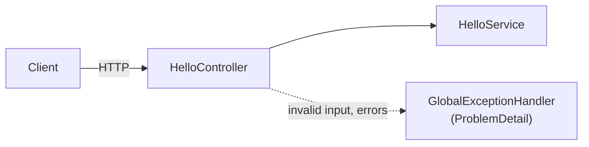

<p align="center">
  
</p>

<h1 align="center">Spring Boot API Boilerplate</h1>

<p align="center">
  A Spring Boot web service built with Maven, ready to deploy on Light Cloud.
</p>

<p align="center">
  <a href="https://console.light-cloud.com/new?repo=https://github.com/light-cloud-com/starter-springboot"></a>
</p>

---

## Features

- Spring Boot 3.5 on Java 17, built with Maven (wrapper included, no local Maven needed)
- Package-by-feature layout: controller, service and record DTOs side by side
- Request validation with Jakarta Bean Validation
- One global exception handler: every error is an RFC 9457 problem (`application/problem+json`)
- Slice tests with `@WebMvcTest` and MockMvc
- `server.port` reads `$PORT`; without it the app listens on 8080 regardless of what the platform asked for

## How it works



## API Endpoints

| Method | Endpoint | Description |
|--------|----------|-------------|
| GET | `/` | Welcome message |
| GET | `/hello?name=Ada` | Greets `name` (1 to 50 characters, default `World`); `400` problem otherwise |

## Project structure

```
.
├── pom.xml
├── mvnw, mvnw.cmd, .mvn/            Maven wrapper
└── src
    ├── main
    │   ├── java/com/lightcloud/starter
    │   │   ├── StarterSpringbootApplication.java
    │   │   ├── common/GlobalExceptionHandler.java
    │   │   └── hello/                 HelloController, HelloService, MessageResponse
    │   └── resources/application.properties
    └── test/java/com/lightcloud/starter
        ├── StarterSpringbootApplicationTests.java
        └── hello/HelloControllerTest.java
```

Add a feature as a new package next to `hello/` with its own controller, service and records.

## Local Development

You need Java 17 or newer.

```bash
# Run the application
./mvnw spring-boot:run

# Run the tests
./mvnw test

# Build a jar (the platform runs this, without tests)
./mvnw clean package

# Run the jar
java -jar target/*.jar
```

The API will be available at `http://localhost:8080`. Copy `.env.example` to `.env` for your own settings; Light Cloud sets `PORT` for you.

## Deploy to Light Cloud

### 1. Create an Account

Visit [console.light-cloud.com](https://console.light-cloud.com) and sign up with GitHub or Google.

### 2. Create New Application

1. Click **"New Application"** in the dashboard
2. Select **"Container"** as the deployment type
3. Choose **"Spring Boot"** as the framework

### 3. Connect Repository

- **Option A:** Fork this repository and connect it via GitHub
- **Option B:** Push this code to your own GitHub repository and connect it

### 4. Configure Settings

Light Cloud will auto-detect your settings, but you can verify:

| Setting | Value |
|---------|-------|
| Port | `8080` |
| Start Command | `java -jar target/*.jar` |

### 5. Deploy

Click **"Deploy"** and your API will be live in minutes!

Your API will be available at `https://your-app.light-cloud.io`

## Learn More

This starter began as `Spring Initializr` output and was reorganised by feature.

- [Spring Boot documentation](https://docs.spring.io/spring-boot/)
- [Spring Initializr](https://start.spring.io)
- [Light Cloud documentation](https://docs.light-cloud.com)

---

<p align="center">
  <a href="https://light-cloud.com">Website</a> •
  <a href="https://docs.light-cloud.com">Documentation</a> •
  <a href="https://console.light-cloud.com">Console</a>
</p>

<p align="center">
  Made with ☁️ by <a href="https://light-cloud.com">Light Cloud</a>
</p>
