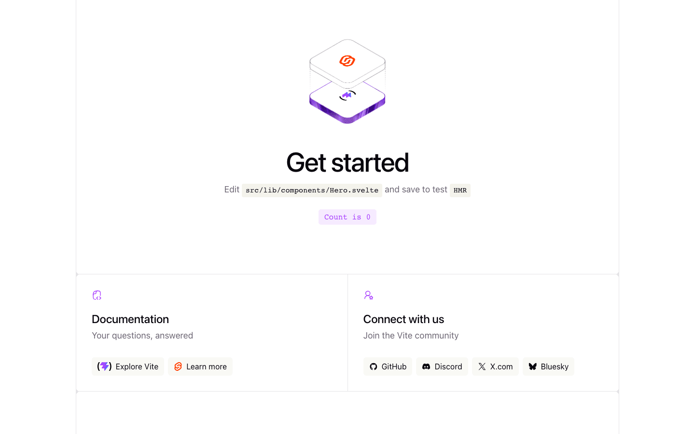
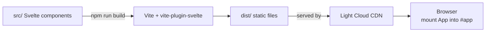

# Svelte 5 Vite Starter

[](LICENSE) [](https://svelte.dev) [](https://vite.dev) [](https://nodejs.org) [](src/lib/components) [](https://github.com/light-cloud-templates/svelte-vite-starter/generate) [](https://www.light-cloud.com/templates/svelte-vite-starter)

A Svelte 5 starter built with Vite 8: a single-page app with runes, scoped component styles and a light and dark theme that follows the visitor's system setting. It is a small JavaScript boilerplate for developers who want a clean Svelte project with ESLint and Vitest already set up, without the routing and server code of SvelteKit. It builds to static files that any static host serves, and deploys to Light Cloud in one click.

## Screenshot

<picture><source media="(prefers-color-scheme: dark)" srcset="docs/screenshots/home-dark.png"></picture>

## Features

- Svelte 5 with runes (`$state`, `$props`) and the new `onclick` event syntax
- Vite 8 with `@sveltejs/vite-plugin-svelte` for the dev server and the build
- Components in `src/lib/components`, each with its own scoped styles
- Design tokens in `src/styles/global.css`, with a dark theme through `prefers-color-scheme`
- ESLint flat config with eslint-plugin-svelte
- Vitest, Testing Library and user-event, with a sample test for the counter
- A `VITE_APP_TITLE` build-time variable, with an `.env.example`

This is one page with no router. When you need several pages, routing or server code, start from [sveltekit-starter](https://github.com/light-cloud-templates/sveltekit-starter) instead.

## Quick start

You need Node.js 22.12 or later (Vitest 5 requires it) and npm.

```bash
git clone https://github.com/light-cloud-templates/svelte-vite-starter.git
cd svelte-vite-starter
npm install
npm run dev
```

Open <http://localhost:5173>. Edit `src/lib/components/Hero.svelte` and the page updates as you save.

Other ways to start:

- **Use this template**: press [Use this template](https://github.com/light-cloud-templates/svelte-vite-starter/generate) to create your own repository from this one.
- **Deploy to Light Cloud**: open the [template page](https://www.light-cloud.com/templates/svelte-vite-starter) and press Deploy to get a running copy.

## Deploy

### Deploy to Light Cloud

[](https://www.light-cloud.com/templates/svelte-vite-starter)

The Deploy button copies this template into your GitHub account and creates a static site: Light Cloud runs `npm run build` and serves the `dist/` folder from a CDN.

There are no secrets to fill in. Every push to the default branch deploys again. Static sites run on the Free plan.

### Deploy anywhere else

This is a standard Vite app with no Light Cloud code in it. Run `npm run build` and upload `dist/` to any static file host (Netlify, Cloudflare Pages, GitHub Pages, S3 with CloudFront, nginx). There is no client-side routing, so no rewrite rules are needed.

## Project structure

```text
.
├── index.html                  # HTML entry, loads src/main.js
├── public/                     # favicon and icon sprite, copied as is into dist/
├── src/
│   ├── main.js                 # mounts App into #app
│   ├── App.svelte              # page composition: Layout, Hero, NextSteps
│   ├── assets/                 # images imported by components
│   ├── lib/components/
│   │   ├── Layout.svelte       # page frame
│   │   ├── Hero.svelte         # logos, title and the counter
│   │   ├── Counter.svelte      # $state counter
│   │   ├── Counter.test.js     # Vitest + Testing Library
│   │   ├── NextSteps.svelte    # documentation and community links
│   │   └── Ticks.svelte        # decorative divider
│   ├── styles/global.css       # design tokens, light and dark theme
│   └── test/setup.js           # jest-dom matchers
├── .env.example                # VITE_ variables
├── eslint.config.js            # ESLint flat config
├── jsconfig.json               # editor type checking for .js and .svelte
├── svelte.config.js            # Svelte compiler options
└── vite.config.js              # Vite and Vitest config
```

## Environment variables

| Name | Required | Default | What it does |
| --- | --- | --- | --- |
| `VITE_APP_TITLE` | No | `Get started` | Heading on the home page. |

Copy `.env.example` to `.env.local` for local runs. Vite only exposes variables that start with `VITE_` to the browser, and it writes their values into the bundle at build time, so never put secrets in them. On Light Cloud, set them in the app's environment variables and deploy again.

## Testing

```bash
npm test          # Vitest, runs once
npm run lint      # ESLint
npm run build     # production build into dist/
npm run preview   # serves dist/ on http://localhost:4173
```

The tests run in jsdom, so no browser is needed.

## How it works



The Svelte compiler turns each component into plain JavaScript at build time, so the browser downloads only a small runtime. `src/main.js` mounts `App.svelte` into the `#app` element in `index.html`.

## FAQ

### What is the difference between Svelte with Vite and SvelteKit?

This template is plain Svelte on Vite: one page, built to static files, no router and no server. SvelteKit adds file-based routing, server-side rendering and server endpoints; use [sveltekit-starter](https://github.com/light-cloud-templates/sveltekit-starter) when you need those.

### How do I add a second page to a Svelte Vite app?

For a few pages, the simplest path is SvelteKit. To stay on this template, add a client-side router package and render a component per path in `App.svelte`; on a host other than Light Cloud you then also need a fallback to `index.html`.

### How do I use environment variables in Svelte with Vite?

Add a line such as `VITE_API_URL=https://api.example.com` to `.env.local` and read it with `import.meta.env.VITE_API_URL`. Only `VITE_` names reach the browser, and the value is fixed when you build.

### Can I deploy it without Light Cloud?

Yes. Run `npm run build` and serve `dist/` from any static file host.

### Does it support Svelte 5 runes?

Yes. The components use runes: `Counter.svelte` uses `$state` and `Layout.svelte` uses `$props` with `{@render children()}`.

## Related templates

- [sveltekit-starter](https://github.com/light-cloud-templates/sveltekit-starter): Svelte with routing and server rendering
- [react-vite-starter](https://github.com/light-cloud-templates/react-vite-starter): a React and Vite single-page app with routing
- [vue-vite-starter](https://github.com/light-cloud-templates/vue-vite-starter): a Vue 3 and Vite single-page app with routing
- [solidjs-vite-starter](https://github.com/light-cloud-templates/solidjs-vite-starter): a SolidJS and Vite app, also compiled with no virtual DOM

## Licence

MIT, see [LICENSE](LICENSE). The home page design comes from the Svelte template of `create-vite`.

---

Maintained by [Light Cloud](https://light-cloud.com): deploy apps, APIs and databases in one click.
