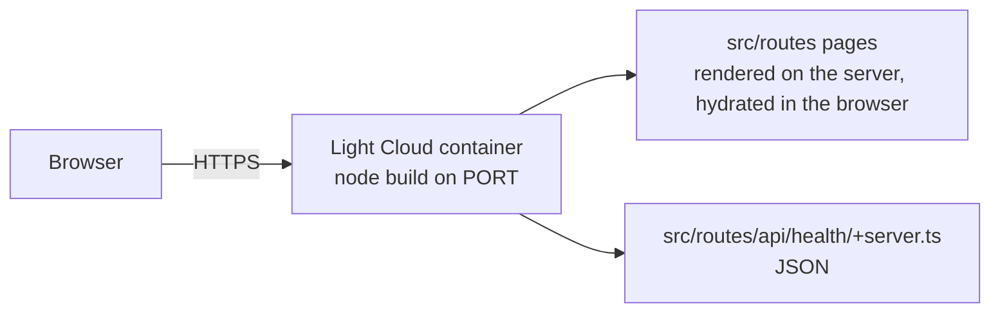

<p align="center">
  
</p>

<h1 align="center">SvelteKit Boilerplate</h1>

<p align="center">
  A SvelteKit app on the Node adapter, ready to deploy on Light Cloud.
</p>

<p align="center">
  <a href="https://console.light-cloud.com/new?repo=https://github.com/light-cloud-com/starter-sveltekit"></a>
</p>

---

## Features

- SvelteKit 2 with Svelte 5 (runes), TypeScript
- `adapter-node`, not `adapter-auto`: Light Cloud runs this as a container
- Root layout with a shared header component in `$lib`
- Home (with a server `load`), About and an API route at `/api/health`
- ESLint (`eslint-plugin-svelte` flat config), Vitest and `svelte-check`
- Builds a Node server to `build/`

## How it works



## Project structure

```text
.
├── src/
│   ├── app.html                    # HTML shell
│   ├── app.css                     # Global styles
│   ├── lib/
│   │   ├── index.ts                # $lib exports
│   │   └── components/SiteHeader.svelte
│   └── routes/
│       ├── +layout.svelte          # Header, main, footer
│       ├── +page.svelte            # / (data from +page.server.ts)
│       ├── +page.server.ts
│       ├── about/+page.svelte      # /about
│       └── api/health/
│           ├── +server.ts          # GET /api/health -> {"status":"ok"}
│           └── server.spec.ts      # Vitest test
├── static/                         # Files served from /
├── .env.example
├── eslint.config.js
└── vite.config.ts                  # SvelteKit, adapter-node and Vitest config
```

## Local development

```bash
npm install       # install dependencies
npm run dev       # dev server on http://localhost:5173
npm run lint      # ESLint
npm run check     # svelte-check type checking
npm test          # Vitest
npm run build     # production build into build/
npm start         # run the production server (honours PORT)
```

## Environment variables

Copy `.env.example` to `.env`. `PUBLIC_*` variables are readable in browser code through `$env/dynamic/public`; anything else is server-only (`$env/dynamic/private`). Dynamic env is read when the server starts, so changing a value on Light Cloud does not need a code change.

## Deploy to Light Cloud

### 1. Create an Account

Visit [console.light-cloud.com](https://console.light-cloud.com) and sign up with GitHub or Google.

### 2. Create New Application

1. Click **"New Application"** in the dashboard
2. Select **"Container"** as the deployment type
3. Choose **"SvelteKit"** as the framework

### 3. Connect Repository

- **Option A:** Fork this repository and connect it via GitHub
- **Option B:** Push this code to your own GitHub repository and connect it

### 4. Configure Settings

Light Cloud will auto-detect your settings, but you can verify:

| Setting | Value |
|---------|-------|
| Port | `3000` |
| Start Command | `npm start` |

### 5. Deploy

Click **"Deploy"** and your app will be live in minutes!

Your app will be available at `https://your-app.light-cloud.io`

## Learn More

This starter began as `npx sv create` output and adds the structure described above.

- [SvelteKit documentation](https://svelte.dev/docs/kit)
- [`sv` CLI](https://github.com/sveltejs/cli)
- [Light Cloud documentation](https://docs.light-cloud.com)

## License

[MIT](./LICENSE)

---

<p align="center">
  <a href="https://light-cloud.com">Website</a> •
  <a href="https://docs.light-cloud.com">Documentation</a> •
  <a href="https://console.light-cloud.com">Console</a>
</p>

<p align="center">
  Made with ☁️ by <a href="https://light-cloud.com">Light Cloud</a>
</p>
