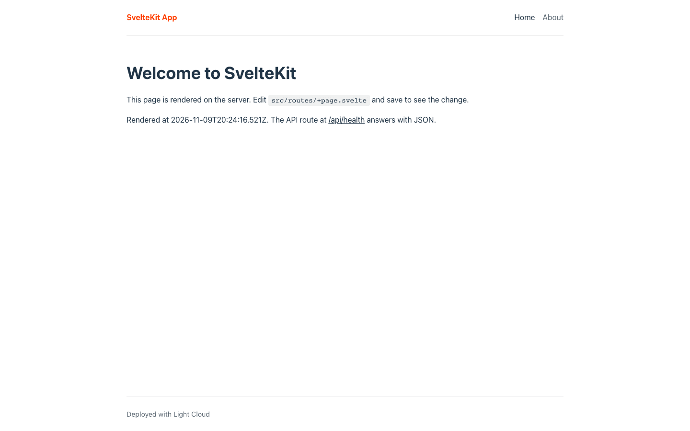
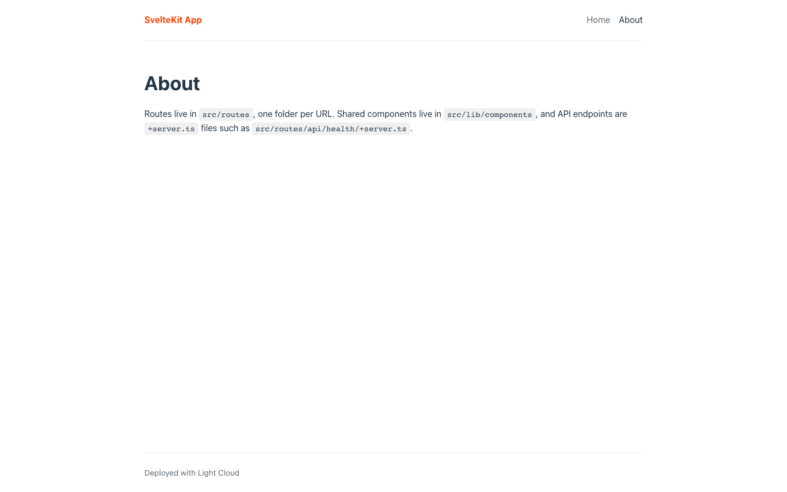
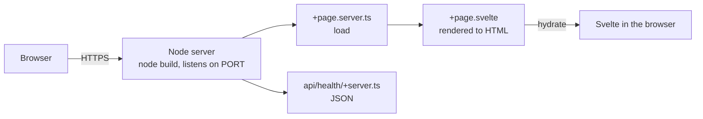

# SvelteKit Starter (Node Adapter)

[](LICENSE) [](https://svelte.dev/docs/kit) [](https://svelte.dev) [](https://www.typescriptlang.org) [](src/routes/api/health) [](https://github.com/light-cloud-templates/sveltekit-starter/generate) [](https://www.light-cloud.com/templates/sveltekit-starter)

A SvelteKit 2 starter with Svelte 5 runes and TypeScript, built with `@sveltejs/adapter-node` into a Node.js server that renders every page on the server. It is a small boilerplate for developers who want a working server-rendered SvelteKit app with a shared layout, a server `load` function, a JSON API endpoint, ESLint, `svelte-check` and Vitest, on Vite 8. It runs on any host that runs Node.js, and deploys to Light Cloud in one click.

## Screenshot




## Features

- SvelteKit 2.70 with Svelte 5.56 in runes mode, on Vite 8
- `adapter-node` instead of `adapter-auto`, so the build is a plain Node.js server in `build/`
- Root layout with a shared `SiteHeader` component in `src/lib`, imported through `$lib`
- Home page with a server `load` in `+page.server.ts`, an About page, and SvelteKit's default error page
- A `+server.ts` endpoint at `GET /api/health` that answers `{ "status": "ok" }`
- `PUBLIC_SITE_NAME` read at runtime through `$env/dynamic/public`
- ESLint 9 flat config with `typescript-eslint` and `eslint-plugin-svelte`
- Type checking with `svelte-check` and a Vitest test for the endpoint
- SvelteKit and Vitest configured in one file, `vite.config.ts`

## Quick start

You need Node.js 20.19 or later (or 22.12 or later) and npm. `.npmrc` sets `engine-strict=true`, so `npm install` stops on an older Node.js.

```bash
git clone https://github.com/light-cloud-templates/sveltekit-starter.git
cd sveltekit-starter
npm install
cp .env.example .env
npm run dev
```

Open <http://localhost:5173>. Edit `src/routes/+page.svelte` and the page updates.

Other ways to start:

- **Use this template**: press [Use this template](https://github.com/light-cloud-templates/sveltekit-starter/generate) to create your own repository from this one.
- **Deploy to Light Cloud**: open the [template page](https://www.light-cloud.com/templates/sveltekit-starter) and press Deploy to get a running copy.

## Deploy

### Deploy to Light Cloud

[](https://www.light-cloud.com/templates/sveltekit-starter)

The Deploy button copies this template into your GitHub account and creates a server app: Light Cloud runs `npm run build`, then `npm start` (`node build`) in a container that listens on the port in `PORT`.

There are no secrets to fill in. Every push to the default branch deploys again. The Free plan includes up to 3 server apps.

### Deploy anywhere else

This is a standard SvelteKit app with no Light Cloud code in it. Any host that runs Node.js 20.19 or later runs it: `npm ci`, `npm run build`, then `node build`. The server reads `PORT` (default `3000`) and `HOST` (default `0.0.0.0`). To target a platform with its own adapter, swap `adapter-node` for that adapter in `vite.config.ts`.

## Project structure

```text
.
├── src/
│   ├── app.html                     # HTML shell
│   ├── app.css                      # global styles
│   ├── app.d.ts                     # App namespace types
│   ├── lib/
│   │   ├── index.ts                 # $lib exports
│   │   ├── assets/favicon.svg
│   │   └── components/SiteHeader.svelte
│   └── routes/
│       ├── +layout.svelte           # header, main, footer
│       ├── +page.svelte             # /
│       ├── +page.server.ts          # server load for /
│       ├── about/+page.svelte       # /about
│       └── api/health/
│           ├── +server.ts           # GET /api/health
│           └── server.spec.ts       # Vitest test
├── static/                          # files served from / (robots.txt)
├── .env.example                     # the variables, for local runs
├── .npmrc                           # engine-strict=true
├── eslint.config.js                 # ESLint flat config
├── tsconfig.json
└── vite.config.ts                   # SvelteKit, adapter-node and Vitest config
```

## Pages

| Path | File | What it shows |
| --- | --- | --- |
| `/` | `src/routes/+page.svelte` | Welcome page with the render time from `+page.server.ts` |
| `/about` | `src/routes/about/+page.svelte` | Where routes, components and API endpoints live |

## API endpoints

| Method | Path | Description |
| --- | --- | --- |
| `GET` | `/api/health` | Answers `200` with `{ "status": "ok" }` |

```bash
curl http://localhost:5173/api/health
```

After `npm run build && npm start` the server is on port `3000`; on Light Cloud, use your app's URL.

## Environment variables

| Name | Required | Default | What it does |
| --- | --- | --- | --- |
| `PORT` | No | `3000` | Port the production server listens on. Set by Light Cloud. |
| `PUBLIC_SITE_NAME` | No | `SvelteKit App` | Site name in the header, read when the server starts. |

`PUBLIC_*` variables can be imported in browser code through `$env/dynamic/public`, so never put secrets in them. Other variables are server-only, through `$env/dynamic/private`.

## Testing

```bash
npm test          # Vitest
npm run lint      # ESLint
npm run check     # svelte-check type checking
```

## How it works



For each request to `/`, the server runs the `load` function, renders `+page.svelte` with its data, and sends HTML that Svelte then hydrates in the browser. `+server.ts` files answer HTTP requests directly.

## FAQ

### Why adapter-node instead of adapter-auto?

`adapter-auto` only recognises a fixed list of hosting platforms. `adapter-node` builds a standard Node.js server that runs in any container, on Light Cloud or anywhere else.

### How do I add a page in SvelteKit?

Create a folder in `src/routes/` with a `+page.svelte` in it: `src/routes/contact/+page.svelte` becomes `/contact`. Add a `+page.server.ts` next to it if the page needs data loaded on the server, and add the link to `SiteHeader.svelte`.

### How do I add an API endpoint in SvelteKit?

Create a `+server.ts` file and export a function per HTTP method, as in `src/routes/api/health/+server.ts`. `src/routes/api/hello/+server.ts` with `export const GET` answers `GET /api/hello`.

### How do I use environment variables in SvelteKit?

Import from `$env/dynamic/private` in server code and from `$env/dynamic/public` for `PUBLIC_` variables in browser code. Dynamic variables are read when the server starts, so changing one on Light Cloud needs no code change.

### Can I deploy it without Light Cloud?

Yes. It is a plain SvelteKit app: any host with Node.js 20.19 or later runs it with `npm run build` and `node build`.

## Related templates

- [svelte-vite-starter](https://github.com/light-cloud-templates/svelte-vite-starter): a Svelte single-page app served as static files
- [nextjs-app-router-starter](https://github.com/light-cloud-templates/nextjs-app-router-starter): the same pages in Next.js
- [nuxt-ssr-starter](https://github.com/light-cloud-templates/nuxt-ssr-starter): the same pages in Nuxt and Vue
- [remix-vite-starter](https://github.com/light-cloud-templates/remix-vite-starter): the same pages in Remix v2

## Licence

MIT, see [LICENSE](LICENSE).

---

Maintained by [Light Cloud](https://light-cloud.com): deploy apps, APIs and databases in one click.
