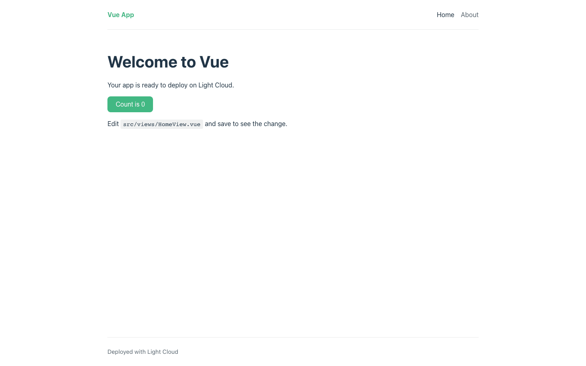
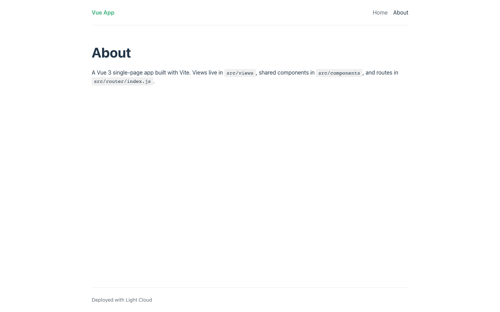
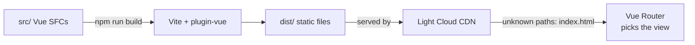

# Vue 3 Vite Starter

[](LICENSE) [](https://vuejs.org) [](https://vite.dev) [](https://router.vuejs.org) [](src/components/__tests__) [](https://github.com/light-cloud-templates/vue-vite-starter/generate) [](https://www.light-cloud.com/templates/vue-vite-starter)

A Vue 3 starter built with Vite 5 and Vue Router 4: a single-page app with a shared layout, a home page, an about page and a 404 page, written with the Composition API and `<script setup>`. It is a small JavaScript boilerplate for developers who want a clean Vue project with scoped styles, ESLint and Vitest already set up, ready to add their own views. It builds to static files that any static host serves, and deploys to Light Cloud in one click.

## Screenshot




## Features

- Vue 3 single-file components with the Composition API and `<script setup>`
- Vite 5 for the dev server and the production build, with an `@` alias for `src/`
- Vue Router 4 with HTML5 history: Home, About and a catch-all 404 view
- About and 404 views are lazy-loaded, so each is its own chunk fetched on first visit
- A `DefaultLayout` (header, navigation, footer) around every view
- Scoped styles per component, design tokens and base styles in `src/assets/main.css`
- ESLint flat config with eslint-plugin-vue, Vitest with Vue Test Utils
- A `VITE_APP_TITLE` build-time variable, with an `.env.example`

## Quick start

You need Node.js 20.19 or later (ESLint 10 requires it) and npm.

```bash
git clone https://github.com/light-cloud-templates/vue-vite-starter.git
cd vue-vite-starter
npm install
npm run dev
```

Open <http://localhost:5173>. Edit `src/views/HomeView.vue` and the page updates as you save.

Other ways to start:

- **Use this template**: press [Use this template](https://github.com/light-cloud-templates/vue-vite-starter/generate) to create your own repository from this one.
- **Deploy to Light Cloud**: open the [template page](https://www.light-cloud.com/templates/vue-vite-starter) and press Deploy to get a running copy.

## Deploy

### Deploy to Light Cloud

[](https://www.light-cloud.com/templates/vue-vite-starter)

The Deploy button copies this template into your GitHub account and creates a static site: Light Cloud runs `npm run build` and serves the `dist/` folder from a CDN. Paths that are not files, such as `/about`, fall back to `index.html`, so Vue Router handles them.

There are no secrets to fill in. Every push to the default branch deploys again. Static sites run on the Free plan.

### Deploy anywhere else

This is a standard Vite app with no Light Cloud code in it. Run `npm run build` and upload `dist/` to any static file host (Netlify, Cloudflare Pages, GitHub Pages, S3 with CloudFront, nginx). The router uses HTML5 history mode, so configure the host to serve `index.html` for paths that do not match a file, or `/about` returns a 404 on reload.

## Project structure

```text
.
├── index.html                    # HTML entry, loads src/main.js
├── public/                       # copied as is into dist/
├── src/
│   ├── main.js                   # creates the app and installs the router
│   ├── App.vue                   # DefaultLayout around <RouterView />
│   ├── assets/main.css           # design tokens and base styles
│   ├── components/
│   │   ├── CounterButton.vue     # the button on the home page
│   │   └── __tests__/            # Vitest + Vue Test Utils
│   ├── layouts/DefaultLayout.vue # header, navigation, footer
│   ├── router/index.js           # route table
│   └── views/                    # HomeView, AboutView, NotFoundView
├── .env.example                  # VITE_ variables
├── eslint.config.js              # ESLint flat config
└── vite.config.js                # Vite and Vitest config, @ alias
```

## Pages

| Path | File | What it shows |
| --- | --- | --- |
| `/` | `src/views/HomeView.vue` | Welcome text and a click counter |
| `/about` | `src/views/AboutView.vue` | Where views, components and routes live (lazy-loaded) |
| any other path | `src/views/NotFoundView.vue` | "Page not found" with a link home (lazy-loaded) |

Routes are declared in `src/router/index.js`; links in the header are in `src/layouts/DefaultLayout.vue`.

## Environment variables

| Name | Required | Default | What it does |
| --- | --- | --- | --- |
| `VITE_APP_TITLE` | No | `Vue App` | Name shown in the header. |

Copy `.env.example` to `.env.local` for local runs. Vite only exposes variables that start with `VITE_` to the browser, and it writes their values into the bundle at build time, so never put secrets in them. On Light Cloud, set them in the app's environment variables and deploy again.

## Testing

```bash
npm test          # Vitest, runs once
npm run lint      # ESLint
npm run build     # production build into dist/
npm run preview   # serves dist/ on http://localhost:4173
```

The tests run in jsdom, so no browser is needed.

## How it works



Vite compiles the single-file components into `dist/`. The browser loads `index.html` and the main bundle once, then Vue Router swaps views and fetches lazy chunks as they are needed.

## FAQ

### How do I add a new page in a Vue 3 Vite app?

Create a view in `src/views/`, add `{ path: '/contact', name: 'contact', component: () => import('@/views/ContactView.vue') }` to the routes in `src/router/index.js`, and add a `<RouterLink to="/contact">` in `src/layouts/DefaultLayout.vue`.

### Why does my Vue Router page show a 404 after a refresh?

HTML5 history mode needs the host to serve `index.html` for unknown paths. Add a rewrite or SPA fallback on your host. Light Cloud does this for you.

### How do I use environment variables in Vue with Vite?

Add a line such as `VITE_API_URL=https://api.example.com` to `.env.local` and read it with `import.meta.env.VITE_API_URL`. Only `VITE_` names reach the browser, and the value is fixed when you build.

### Can I deploy it without Light Cloud?

Yes. Run `npm run build` and serve `dist/` from any static file host, with a fallback to `index.html` for client-side routes.

### Does it include Pinia or TypeScript?

No, it keeps to Vue and Vue Router. Install `pinia` and call `app.use(createPinia())` in `src/main.js` when you need shared state; Vite already compiles `<script setup lang="ts">`; add `typescript` and `vue-tsc` when you want type checking.

## Related templates

- [react-vite-starter](https://github.com/light-cloud-templates/react-vite-starter): the same app in React and Vite
- [solidjs-vite-starter](https://github.com/light-cloud-templates/solidjs-vite-starter): the same app in SolidJS and TypeScript
- [svelte-vite-starter](https://github.com/light-cloud-templates/svelte-vite-starter): a single-page Svelte 5 app on Vite
- [nuxt-ssr-starter](https://github.com/light-cloud-templates/nuxt-ssr-starter): Vue with server rendering in Nuxt
- [angular-starter](https://github.com/light-cloud-templates/angular-starter): the same app in Angular

## Licence

MIT, see [LICENSE](LICENSE).

---

Maintained by [Light Cloud](https://light-cloud.com): deploy apps, APIs and databases in one click.
